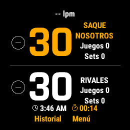

# Padel al Tanto

[](https://github.com/mlizaso/garmin-padel-al-tanto/actions/workflows/connect-iq.yml)

Marcador de pádel para el **Garmin fēnix 7 y fēnix 7 Pro de 47 mm**. La pareja que saca aparece arriba. Puedes anotar con botones o toques, deshacer, llevar solo los juegos y grabar la actividad con el pulso. Admite partidos por sets y rondas de americano de duración configurable. La interfaz está en español e inglés. La estimación de golpes con el movimiento de la muñeca está desactivada por defecto. Puedes activarla en **Ajustes → Detección de golpes**.



En **Jugar**, elige una plantilla o configura el partido en **Manual**, selecciona la pareja que saca y pulsa **Iniciar**. En **Plantillas** puedes crear, editar y eliminar tus formatos. Los partidos al mejor de tres admiten un súper tie-break a diez, con dos puntos de ventaja, en lugar del tercer set. El marcador muestra la hora y el tiempo total de juego.

Para jugar, descarga el paquete USB de la [última versión](https://github.com/mlizaso/garmin-padel-al-tanto/releases/latest), elige el PRG de tu modelo y sigue la [guía de instalación y controles](PadelAlTanto/LEEME.md) o el [manual visual](Manual-visual-Padel-al-Tanto.pdf). La [galería](Vista-previa/Galeria.html) se puede abrir en un navegador desde una copia local del proyecto.

**For players:** download the USB package from the [latest release](https://github.com/mlizaso/garmin-padel-al-tanto/releases/latest). Copy your model’s `PADELAT.PRG` to `GARMIN/APPS` on your watch and disconnect it. The app follows the watch language, using English for languages other than Spanish. You can choose either language under **Settings → Language**. Wrist-based stroke detection is off by default. Turn it on under **Settings → Stroke detection**.

**Play** lets you pick a saved template or set up a match manually, then choose the first serving pair and start recording. **Templates** manages your saved formats. Best-of-three matches can use a ten-point match tiebreak at one set all. The scoreboard shows the local time and elapsed match time.

## Desarrollo y pruebas

El proyecto Monkey C está en `PadelAlTanto/`. Instala Java 17, el SDK Connect IQ 9.3.0 y los perfiles `fenix7` y `fenix7pro` con [Garmin SDK Manager](https://developer.garmin.com/connect-iq/sdk/). En VS Code puedes abrir esa carpeta y usar la extensión Monkey C. Para probar la versión distribuida en macOS, ejecuta `./Abrir-simulador.command` desde la raíz.

Con el directorio `bin` del SDK en el PATH y el simulador abierto, puedes compilar y probar un modelo desde la raíz. Usa una clave de desarrollo propia en formato DER.

```sh
mkdir -p bin
monkeyc -f PadelAlTanto/monkey.jungle -d fenix7 -r -y /ruta/a/tu-clave.der -o bin/PADELAT.PRG
monkeyc -f PadelAlTanto/monkey.jungle -d fenix7 -t -y /ruta/a/tu-clave.der -o bin/tests.prg
python3 scripts/run_tests.py fenix7 bin/tests.prg
```

Para el modelo Pro, sustituye `fenix7` por `fenix7pro` en los tres comandos. Las pruebas cubren el tanteo, los sets y desempates, el americano, las plantillas, los gestos, el idioma y la lógica de grabación y detección de golpes. La precisión del sensor y la sensación de la vibración se comprueban en pista.

En cada pull request y cada cambio en `main`, [GitHub Actions](.github/workflows/connect-iq.yml) lee los modelos del manifiesto y compila la versión de distribución y la de pruebas para cada reloj. Lee la lista de pruebas generada por el compilador y abre un simulador nuevo para cada caso. Así, las grabaciones de una prueba no interfieren con la siguiente. La CI comprueba el nombre y resultado de cada caso y falla si falta alguno. Cada ejecución genera su propia clave temporal. El flujo fija la huella del SDK oficial y de la [imagen de Linux con los perfiles y fuentes](https://github.com/matco/connectiq-tester). Al actualizar el SDK o los perfiles, actualiza la huella correspondiente y comprueba los resultados de los simuladores.

## Preparar el paquete USB

Crea el ZIP público con el PRG de distribución de cada modelo, el manual PDF y los archivos versionados de `PadelAlTanto/`. En la raíz del ZIP van `PADELAT.PRG` para el fēnix 7 y `Manual-visual-Padel-al-Tanto.pdf`. Coloca el PRG del modelo Pro en `fenix7pro/PADELAT.PRG`. Usa el archivo `.iq` para el envío a la tienda Connect IQ.

## Actualizar el manual y la galería

Las capturas originales y los generadores están incluidos. Desde la raíz, utiliza Python con Pillow y ReportLab para generar el PDF. El generador usa las fuentes Arial de macOS o las de la carpeta que indiques con `--font-dir`. La galería solo necesita Python.

```sh
python3 tools/manual-visual/manual.py
python3 tools/generar_galeria_padel.py Vista-previa/frames.json Vista-previa/Galeria.html
```
